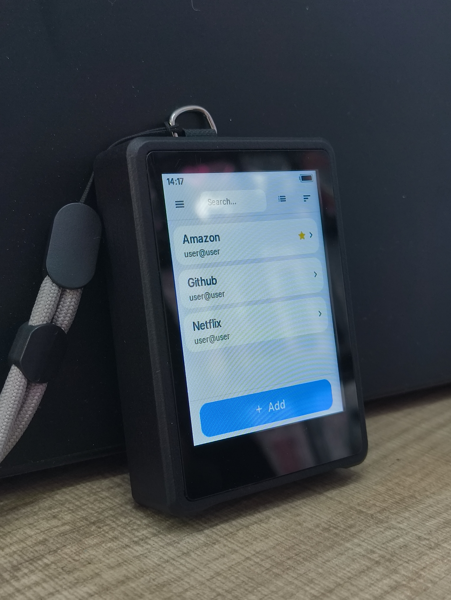
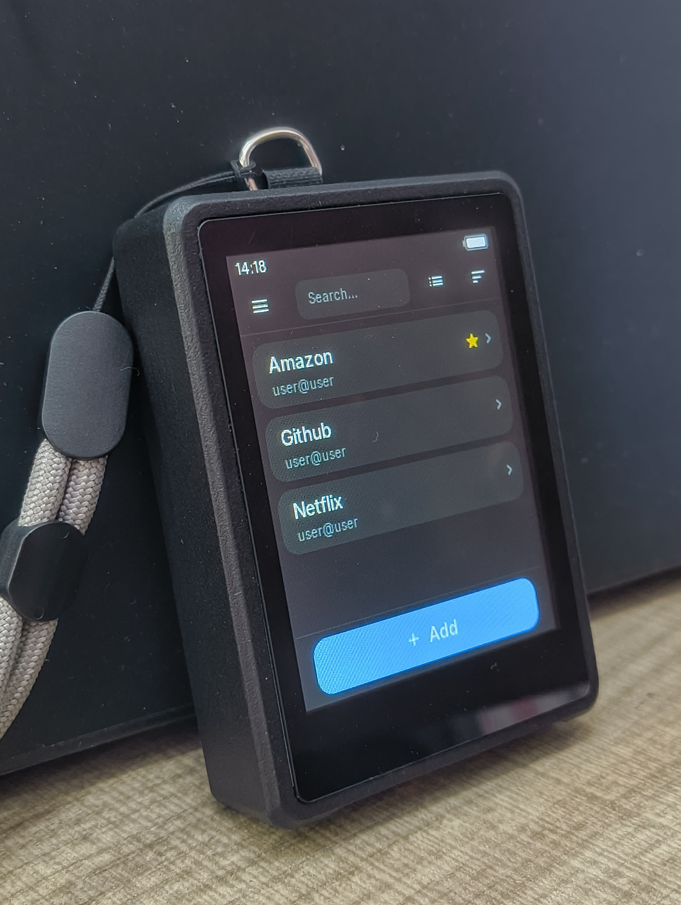
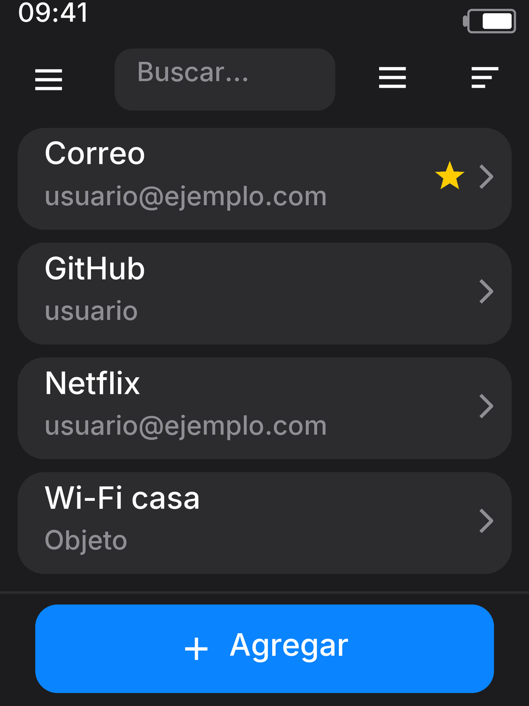
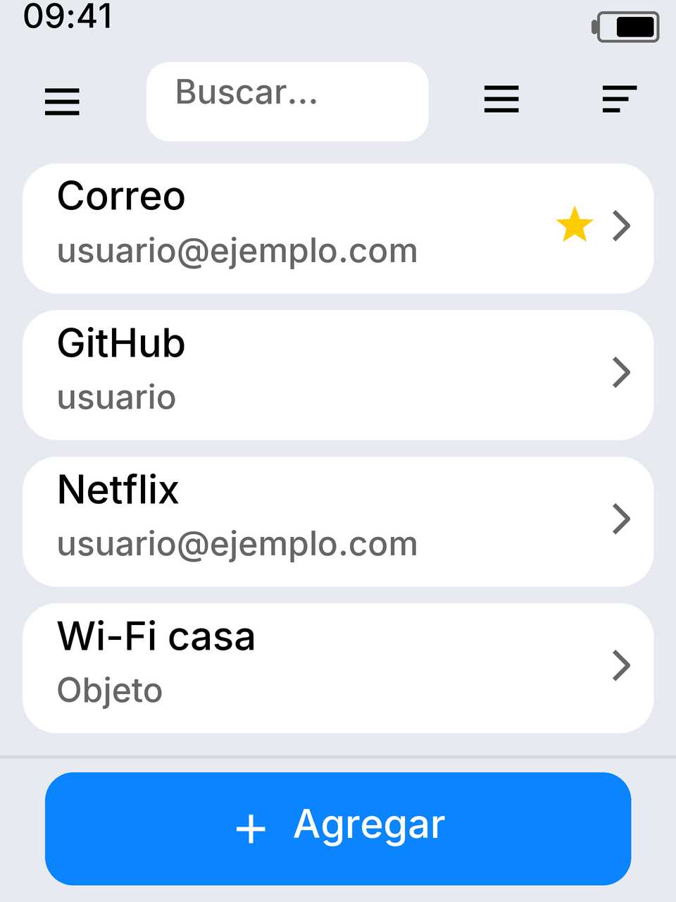
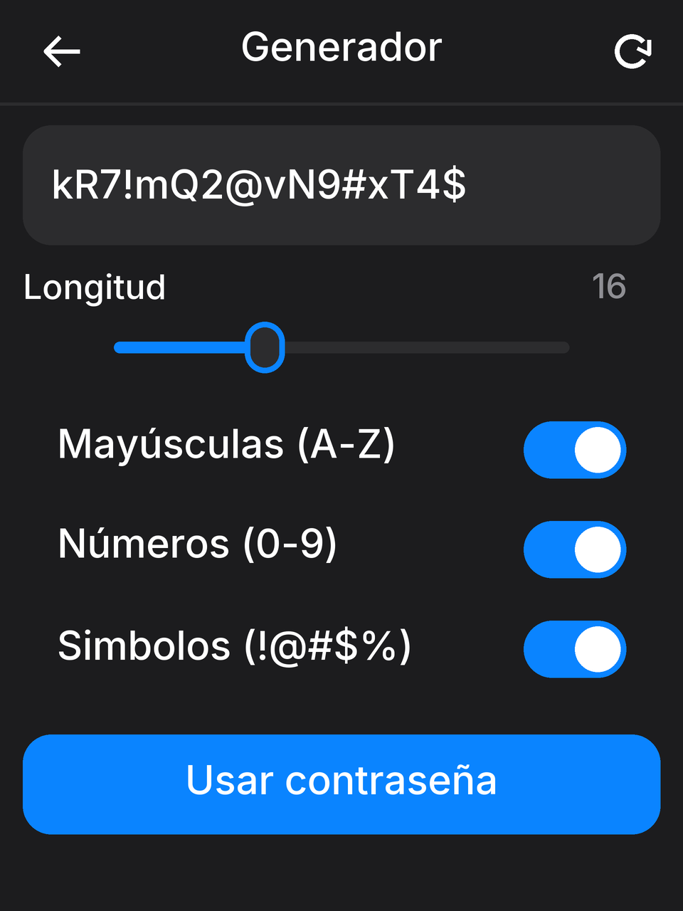
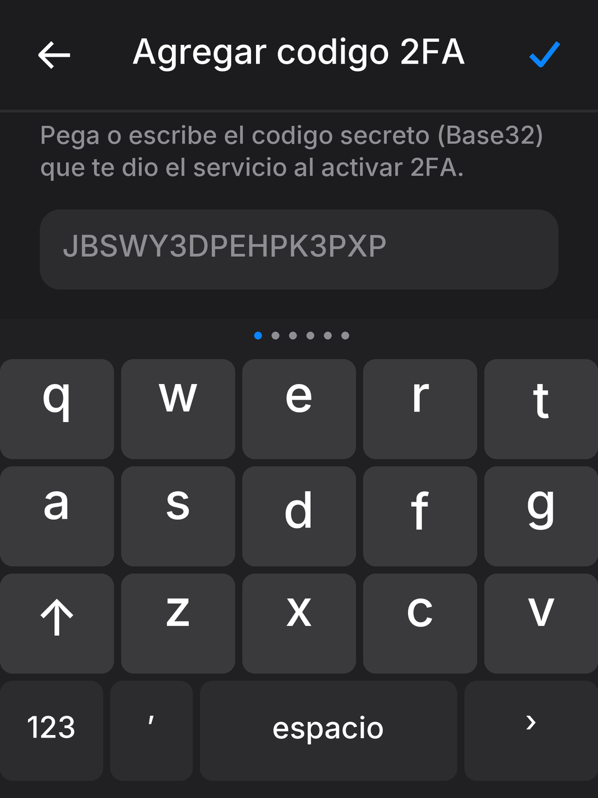

**English** | [Español](README.es.md)

# Huskey Pocket

A hardware password manager built for **Waveshare ESP32-S3-Touch-LCD-2.8**. Store credentials locally, generate TOTP codes, and type data through USB or Bluetooth Low Energy HID without cloud accounts or service dependencies.

**Built and working device**, with physically tested printed parts and enclosure fit.

<p align="center">
  
  
</p>

[Real device photos, renders and interface screens](docs/GALLERY.md).

> **Reference project, without active maintenance.** Shared under the MIT License, as is, without guaranteed support, fixes or feature updates. Forks and independent development are welcome.

**3D printing:** [3MF ready for Bambu Lab A1 · PETG · 0.4 mm nozzle](hardware/Huskey_Pocket_A1_PETG_04.3mf) · [Settings and instructions](hardware/bambu/README.md#english).

## Features

### Initial setup (onboarding)

- Language selection, welcome and privacy-notice screens.
- Guided date, time, input-language, touch-keyboard, automatic-lock and theme configuration.
- Master PIN creation and confirmation.
- Vault preparation progress and setup-completion screens.

### Date and time

- Manual day, month, year, hour and minute settings in onboarding and Settings.
- **12-hour or 24-hour** format and a status-bar clock.
- Time-zone offsets from **UTC−12 to UTC+14**, in 30-minute steps.
- A **PCF85063** RTC keeps time and supports TOTP without internet synchronization. Date, time and TOTP functions require an **external RTC backup battery** to retain the date and time while the device is powered off.

### Credentials and organization

- Accounts with title, username, password, notes/URL and TOTP secret; secret and note records.
- Create and edit entries, folders and categories; rename and move records.
- Favorites and hidden sensitive fields with a reveal option.
- Visual data transfer through QR codes.

### Views, search, filters and sorting

- **List** and **three-column icon grid** entry views.
- Sort by **name A–Z**, **name Z–A**, **newest first** or **oldest first**; date sorting uses entry creation time.
- Folder/category and favorites filters, plus search by name or username.
- Multiple selection, select all entries in the current view and batch deletion.
- View mode and sorting choices are saved in preferences.

### PIN and vault

- A **6-digit master PIN**, with changes from Settings and entry re-encryption.
- **AES-256-CBC**, a random IV per operation and **50,000-iteration PBKDF2-HMAC-SHA256**.
- LittleFS vault storage and NVS configuration.
- A persistent attempt counter: **five consecutive incorrect PIN attempts reset the device and erase the vault**.

### Decoy PIN

- An alternate PIN, different from the real one, opens an empty vault without access to real credentials.
- Saves in the decoy session are simulated.
- A configurable **2-, 5- or 10-minute** timer resets the device and erases the vault when it expires.
- Enable, change or disable the decoy PIN from Settings.

### Factory reset and FRP

- Manual factory reset from Settings, with a confirmation notice, entry of the word **`Reset`** and a **5-second** press-and-hold.
- Deletes entries, the access PIN, folders and device preferences.
- **Factory Reset Protection (FRP)** retains verification of the previous PIN and requests it before device setup can resume.
- **Three incorrect FRP attempts** activate the firmware's permanent lockout.

### Locking and physical protection

- Idle locking after **30 seconds, 1, 2 or 5 minutes**, or disabled.
- **Snatch Lock**: QMI8658C acceleration and rotation detection, followed by locking and Deep Sleep. Low, medium, high or disabled sensitivity.
- **Lost mode**: a factory reset at startup after **7, 14, 30, 60, 90 or 180 days** without a real-PIN unlock, depending on configuration.

### USB and Bluetooth keyboards

- **USB HID** and wireless **Bluetooth Low Energy HID** keyboard modes.
- **ES-LAT, ES-ES and US** layouts, including letter, symbol and modifier mappings.
- Type a username followed by Tab, a password followed by Enter, TOTP codes or generated passwords.
- Pairing-code confirmation and Bluetooth bonded-device management.

### T9 and QWERTY touch keyboards

- Keyboard-type selection in onboarding and Settings.
- **Sliding QWERTY**: two letter pages and four symbol pages, with Shift and Caps Lock.
- **4 × 4 T9**: phone-style multitap letters, with long-press numbers and shortcuts.
- Delete, confirm and panel-switching controls while typing.

### Interface personalization

- **Spanish and English**, plus **light, dark and custom** themes.
- Independent **background**, **card** and **accent** colors, with hue and saturation controls.
- Light or dark bases for the custom theme and preset accent colors.
- Automatic text-color adjustment based on the background, toast messages and haptic feedback.

### TOTP and password generation

- **6-digit** HMAC-SHA1 TOTP codes at **30-second** intervals, compatible with RFC 6238, with an on-screen countdown.
- An **8–32-character** generator: lowercase as the base character set, optional uppercase letters, digits and symbols, and an ambiguity filter.
- A standalone generator and form-integrated generation, with direct typing into the connected device.

### Backups and transfer

- **Encrypted `.hky` backups** with a password independent of the PIN and **100,000-iteration PBKDF2**.
- **CSV** import/export; CSV files contain readable plaintext data.
- Block-based imports and exported-file cleanup on microSD.
- **USB Mass Storage (MSC)** access to microSD, with an optional read-only mode.
- Exclusive storage mode: application and keyboard functions are suspended while it is active.

### Battery and power

- The enclosure is designed to accommodate a **3.7 V LiPo battery in the 523450 format**. The RTC uses an external backup battery separate from the main battery.
- LiPo voltage monitoring and battery-level estimation.
- A status-bar level indicator, charging animation and low-battery indication.
- Reading filters and compensation for voltage changes when charging connects or disconnects.
- Lock, restart and shutdown controls, backlight management and Deep Sleep.

### Screenshots and project resources

- **BMP screenshots on microSD** through the serial commands `shot`, `shot2` and `shot3`.
- Source code, manuals, whitepaper, render gallery, UI screens, [editable Blender enclosure](hardware/CASE.blend) and [four STL parts](hardware/STL/) for 3D printing.
- [Bambu Lab A1 3MF project](hardware/Huskey_Pocket_A1_PETG_04.3mf), prepared for **PETG and a 0.4 mm nozzle**: all four parts oriented on one plate, with supports and print settings included for a **textured PEI plate**.

See [FEATURES.md](FEATURES.md) for the module breakdown.

[Version 1.0.1 changes](CHANGELOG.md).

## Getting started

1. Browse the [documentation index](docs/README.md) and user manual.
2. Open [password_manager.ino](firmware/password_manager/password_manager.ino) in Arduino IDE. Keep all sketch files together.
3. Install dependencies and configure the board using the [build guide](docs/BUILD.md).
4. Customize the [privacy notice](docs/PRIVACY.md) before distributing your implementation.
5. Print the enclosure using the [A1 3MF project](hardware/Huskey_Pocket_A1_PETG_04.3mf). Open it as a project in Bambu Studio and click **Slice plate**; see the [printing guide](hardware/bambu/README.md#english) for settings and individual part orientations.

## Privacy notice

**Each person or organization adapting, implementing or distributing Huskey Pocket is responsible for writing, publishing and maintaining their own privacy notice.** Repository authors do not manage this on behalf of third parties.

[privacy_notice.h](firmware/password_manager/privacy_notice.h) holds the Spanish and English text displayed in onboarding and Settings. The default states **“Notice not configured”**; the checkbox acknowledges reading it. Replace the content with your implementation's notice and update its version. The code's MIT License remains in [LICENSE](LICENSE).

## Hardware and build

| Component | Project configuration |
| --- | --- |
| Microcontroller | ESP32-S3, 240 MHz |
| Flash | **16 MB** |
| PSRAM | OPI PSRAM, 8 MB |
| Display / touch | ST7789, 240 × 320 / CST328 |
| RTC / IMU | PCF85063 / QMI8658C |
| External storage | MicroSD, 1-bit SD_MMC |
| Main battery | **523450** format 3.7 V LiPo; enclosure designed for this format |
| RTC backup | External PCF85063 backup battery, required to retain the date and time and support TOTP across power cycles |
| Haptics | Vibration motor |
| USB Mode | **USB-OTG (TinyUSB)** for HID and MSC |

## Required libraries

### Board package

| Package | Version | Installation |
| --- | --- | --- |
| [Espressif Arduino-ESP32](https://docs.espressif.com/projects/arduino-esp32/en/latest/installing.html), `esp32:esp32` | **3.3.10** | Arduino IDE Boards Manager |

### External libraries

Install these versions from the Arduino IDE **Library Manager**:

| Library Manager name | Version | Purpose |
| --- | --- | --- |
| [lvgl](https://github.com/lvgl/lvgl/tree/v8.3.6) | **8.3.6** | Touch interface, widgets, themes, QR and screenshots |
| [NimBLE-Arduino](https://github.com/h2zero/NimBLE-Arduino/releases/tag/2.5.0) | **2.5.0** | Bluetooth Low Energy keyboard, pairing and bonded devices |

### ESP32 package components

| Component | Purpose |
| --- | --- |
| `SPI` and `Wire` | Display, touch, RTC and IMU buses |
| `FS`, `LittleFS` and `SD_MMC` | Internal vault and microSD files |
| `Preferences` | NVS settings and counters |
| `USB`, `USBHID` and `USBMSC` | USB keyboard and mass storage |
| `mbedTLS` | AES, SHA and PBKDF2 key derivation |
| `FreeRTOS` and ESP-IDF APIs | Tasks, sleep, GPIO and ESP32-S3 functions |

These components are installed with **Arduino-ESP32 3.3.10**. ST7789, CST328, PCF85063 and QMI8658C drivers, fonts and touch keyboards are in `firmware/password_manager/`.

Keep [lv_conf.h](firmware/password_manager/lv_conf.h) beside the sketch: it configures 16-bit color, the time tick, QR, snapshots and fonts. The [build guide](docs/BUILD.md) provides installation steps and all board settings.

## Interface

<p align="center">
  
  
  
  
</p>

[View the full gallery](docs/GALLERY.md).

## Repository layout

```text
firmware/password_manager/   Arduino sketch, modules, fonts and lv_conf.h
docs/                       Guides and index
docs/reference/             Manuals and whitepaper (DOCX/PDF)
assets/renders/             Device renders
assets/photos/              Photos of the assembled, working device
assets/ui/                  High-resolution UI references
hardware/CASE.blend         Blender enclosure source
hardware/STL/               3D printing parts: BUTTON, COVER, FRAME and PLATE
hardware/*.3mf              Print project for A1, PETG and a 0.4 mm nozzle
hardware/bambu/             Printing guide and settings in Spanish and English
FEATURES.es.md              Spanish feature description
FEATURES.md                 English feature description
LICENSE                     MIT License
```

## License

[MIT](LICENSE). Third-party dependencies and resources retain their respective licenses; see [THIRD_PARTY_NOTICES.md](THIRD_PARTY_NOTICES.md).
